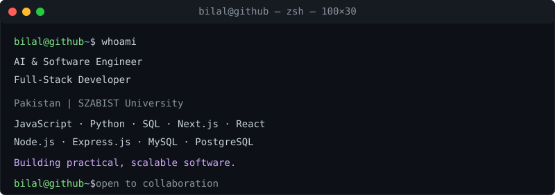
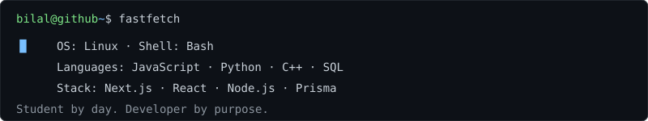

<pre><picture></picture>
<a href="https://github.com/bilalkaxi"><picture></picture></a><a href="https://www.linkedin.com/in/ibn-jamil/"><picture></picture></a><a href="mailto:bilaljamiljtu@gmail.com"><picture></picture></a><a href="https://x.com/bilalkazijtu"><picture></picture></a><a href="https://www.youtube.com/@MuhammadBilal-fu4ip"><picture></picture></a><a href="https://wa.me/923099004292"><picture></picture></a>
<picture></picture>
</pre>

---

| Metrics | Highlights |
| :-- | :-- |
|  | **Projects:** Library Management System · Essential Quranic Arabic **Certifications:** Google AI Professional Certificate · Responsive Web Design **Education:** BS Computer Science — SZABIST University |

<em>Building practical software and learning every day.</em>

